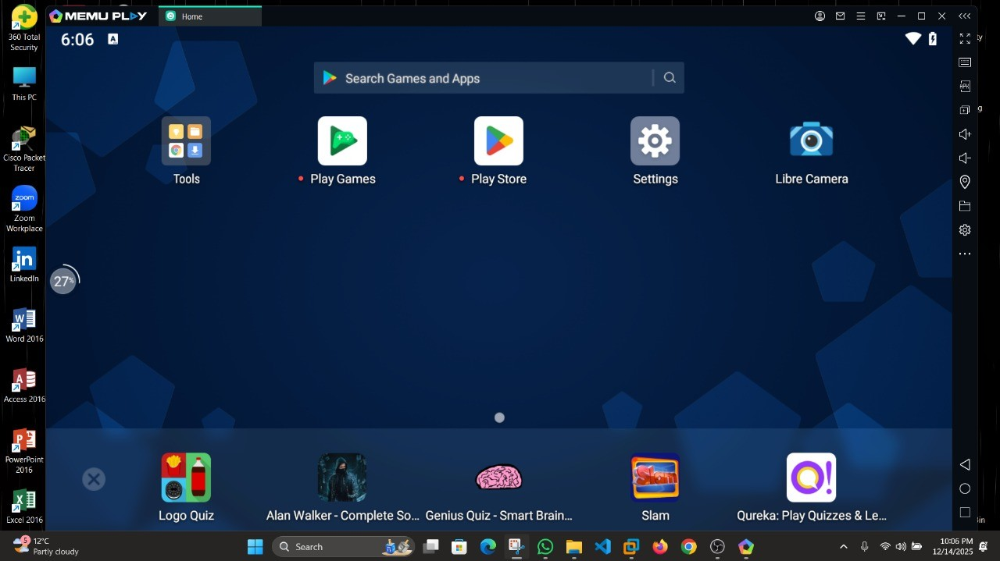
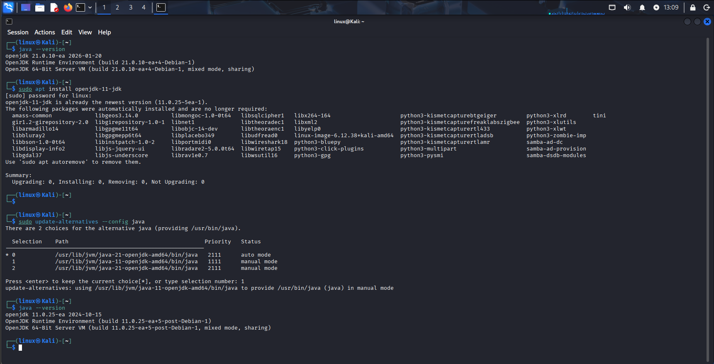
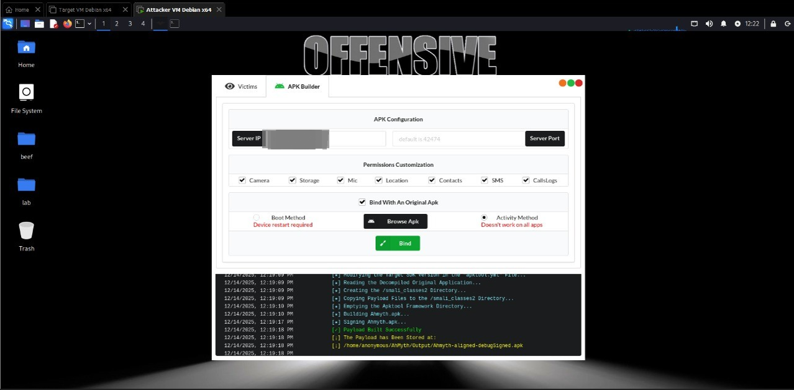
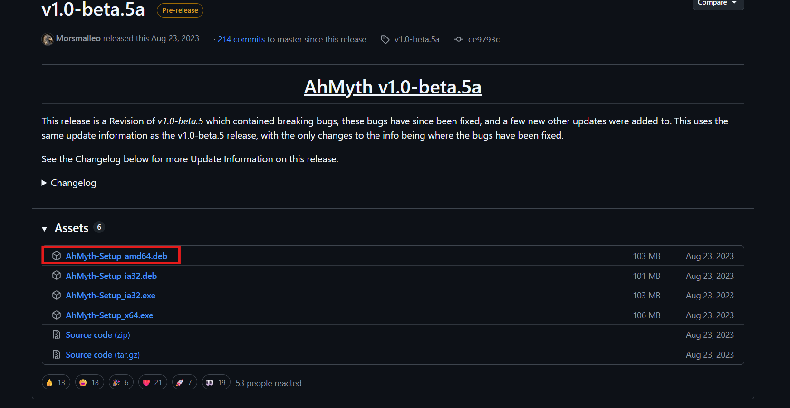
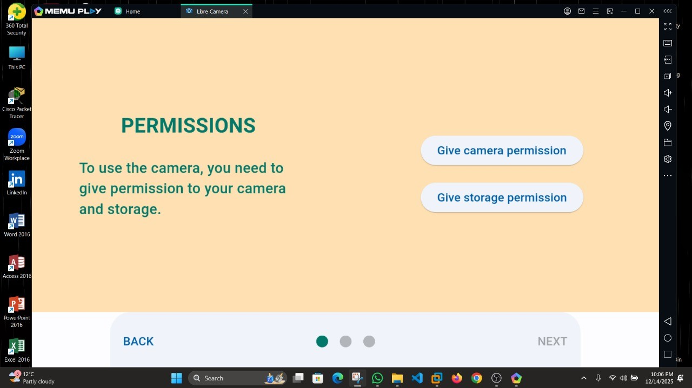
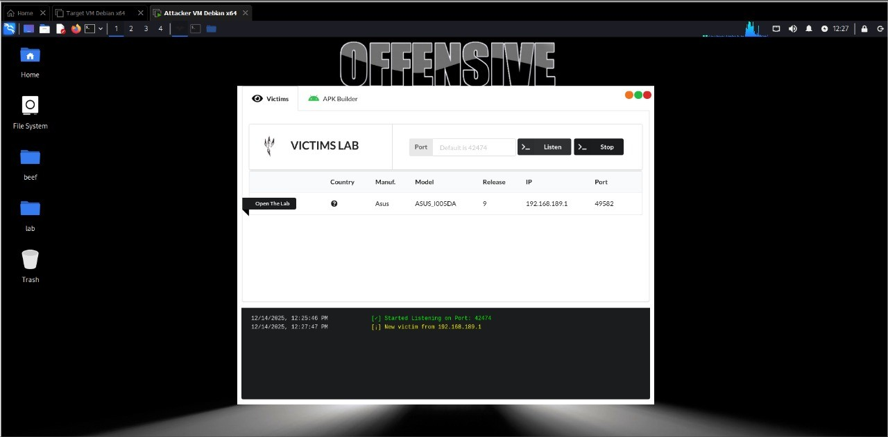
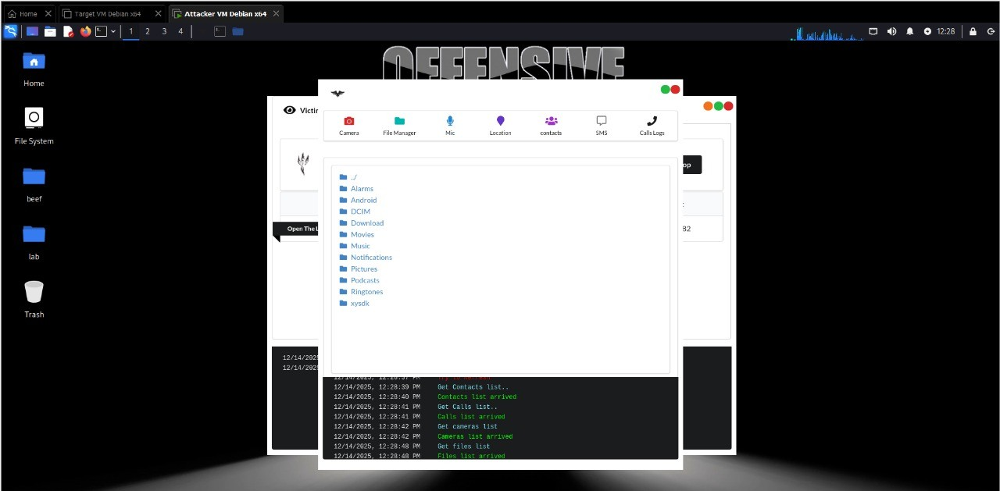

This research examines how an Android Remote Access Trojan (RAT) can be concealed inside an application that appears legitimate. The analysis focused on AhMyth in an isolated virtual lab, using Android 9, to understand the behavior defenders should recognize and the privacy impact a successful infection can have.

## Research scope

The project reviewed the RAT's attacker console and Android component at a high level, then observed their interaction inside a controlled environment. No personal devices or third-party systems were involved. The purpose was to document the threat and derive practical defensive guidance.

The tested sample used a legitimate camera application as its apparent host. This illustrates a key social-engineering risk: familiar branding and expected permission prompts can make a modified app seem trustworthy.

## Lab environment

The analysis was carried out entirely on isolated virtual machines. No personal devices, networks, or third-party services were used.

| Component | Detail |
|---|---|
| Attacker host | Kali Linux (VMware) |
| Victim device | Android 9 (64-bit) via MEmu Play |
| RAT tool | AhMyth v1.0-beta.5a |
| Runtime dependency | OpenJDK 11 |
| Carrier application | LibreCamera (open-source) |

AhMyth requires Java 11, while recent Kali builds default to a newer JDK. Installing OpenJDK 11 and switching the active default resolved the runtime conflict before the console would launch.

The APK Builder was then used to decompile the carrier application, inject the payload classes, and rebuild the signed artifact. The resulting file looks and installs like a normal camera app while carrying the RAT.

## What the analysis observed

After the Android app connected to the lab console, the interface exposed functions associated with sensitive device data and hardware. The breadth of access demonstrates why installing an untrusted app can put much more than the app's own data at risk.

| Capability | Impact |
|---|---|
| Camera | Silent photos from front and rear cameras |
| Microphone | Ambient audio recording |
| Location | Live GPS tracking |
| File manager | Browse and exfiltrate stored files |
| SMS | Read messages, including possible one-time codes |
| Call logs | Full call history |
| Contacts | Address-book harvesting |
| Remote commands | Arbitrary command execution |

The test also observed that the selected launch configuration did not remain connected after the app was uninstalled. This is a result from this specific lab setup; persistence behavior can differ across configurations and samples.

## Evidence from the lab

The project documented the analysis environment, Android permission prompt, app launch, and the console's reported connection. These screenshots are included as supporting evidence from the isolated exercise.

## Defensive takeaways

- Install apps only from trusted sources, and verify the publisher and package before sideloading.
- Treat unexpected permission requests as a warning, even when the app's appearance seems familiar.
- Review and revoke permissions an app does not need; pay particular attention to camera, microphone, location, contacts, messages, and file access.
- Keep Android and apps updated, and use mobile security controls that can flag sideloaded or suspicious applications.
- If compromise is suspected, disconnect the device, remove the suspicious app, change important credentials from a known-clean device, and seek incident-response help when sensitive data may have been exposed.

## Limitations

This was a controlled demonstration with one RAT version and one Android virtual-device configuration. It does not establish how every AhMyth build behaves, nor does it measure detection rates across security products or Android versions.

## References

- [AhMyth project](https://github.com/AhMyth/AhMyth)
- [Android security and permissions](https://developer.android.com/privacy-and-security)
- [Android malware and unwanted software guidance](https://support.google.com/googleplay/answer/2812853)
